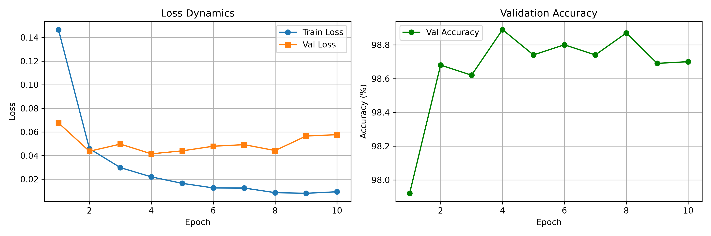
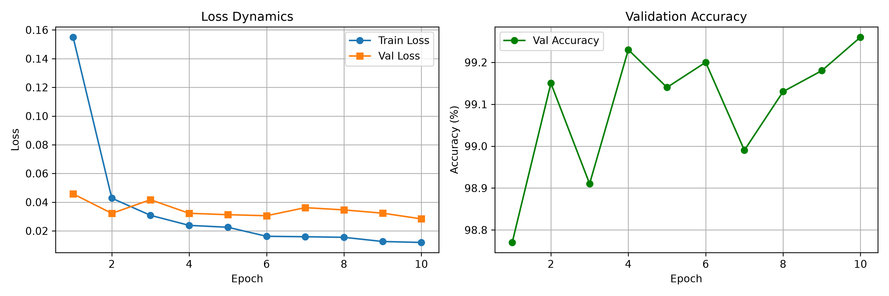
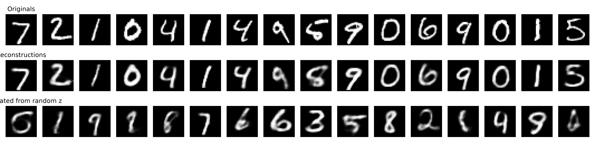

## Структура проекта
```
project/
├── config.py # Централизованные гиперпараметры и пути
├── cnn_0.py # Точка входа: CNN с нуля
├── cnn_transfer.py # Точка входа: Transfer
├── vae.py # Точка входа: VAE
├── clip.py # Точка входа: CLIP Zero-Shot
├── data/
│ └── mnist.py # Загрузчики данных
├── models/
│ ├── cnn.py # Архитектура SimpleCNN
│ ├── resnet_transfer.py # Адаптированная ResNet18 для MNIST
│ └── vae.py # Вариационный автоэнкодер
├── engine/
│ ├── train.py # Цикл обучения (классификация)
│ ├── evaluate.py # Оценка модели (классификация)
│ ├── train_vae.py # Цикл обучения VAE + ELBO loss
│ └── eval_clip.py # Zero-Shot оценка CLIP
── visual/
│ └── plots.py # Визуализация графиков и генераций
└── results/ # Сохранённые графики и изображения
  ├── part1_cnn_scratch.png
  ├── part2_transfer_learning.png
  └── part3_vae_results.png
```

## Установка и запуск
```bash
pip install -r requirements.txt

python cnn_0.py          # Запуск обучения базовой CNN
python cnn_transfer.py # Запуск Transfer Learning
python vae.py      # Запуск обучения VAE
python clip.py     # Запуск Zero-Shot оценки CLIP
```

## Примеры результатов

### Динамика обучения CNN с нуля

*Рис. 1. Снижение функции потерь и рост точности на валидационной выборке в процессе обучения базовой CNN.*

### Динамика обучения CNN с Transfer Learning

*Рис. 2. Снижение функции потерь и рост точности на валидационной выборке в процессе обучения базовой CNN.*

### Генерация изображений VAE

*Рис. 3. Сравнение оригинальных изображений, их реконструкций и новых цифр, сгенерированных из случайного латентного вектора z.*

### Image Classification с помощью CLIP
Классификация на моих настройках показала результат в 47.26%